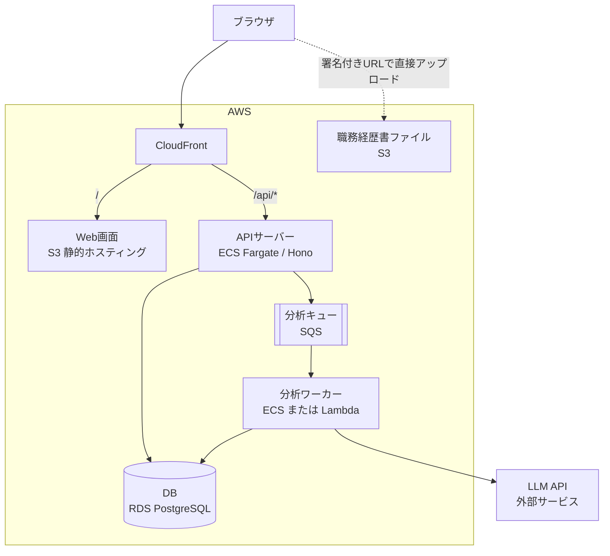

# アーキテクチャ

## 全体構成

## リクエストの流れ

1. ブラウザからのリクエストはすべてCloudFrontが受ける。`/` はS3の静的ファイル、`/api/*` はAPIサーバーへ振り分ける。フロントエンドとAPIが同一ドメインになるため、Cookieによるセッション認証（[ADR-0003](adr/0003-authentication.md)）が成立する。画面はSPAとして静的ファイルのみで配信する（[ADR-0004](adr/0004-frontend-spa.md)）。
2. APIサーバーは分析リクエストを受けると、`analyses` に `pending` で記録してキューに登録し、すぐに 202 を返す（[API設計](api.md)）。
3. 分析ワーカーがキューからジョブを取り出し、LLM APIを呼び出して結果をDBに保存する（[ADR-0001](adr/0001-analysis-result-storage.md)）。
4. 職務経歴書ファイルのみ、署名付きURLを使ってブラウザからS3へ直接アップロードする。

## キューを挟む理由

LLMの応答には数十秒かかる。APIサーバーが応答を直接待つ構成では、リクエストが集中した際にサーバーが詰まり、タイムアウトも起きやすい。キューで分離することで、次の効果を得る。

- APIは即座に応答でき、画面の体感速度が落ちない。
- ワーカーは自分のペースで処理でき、LLM APIのレート制限にも合わせやすい。
- 失敗したジョブを再試行でき、繰り返し失敗したものはデッドレターキューに隔離できる。

## 未決定事項（P2で決定）

| 項目 | 選択肢 | 判断の観点 |
|---|---|---|
| 分析ワーカーの実行基盤 | ECS Fargate / Lambda | 待機時のコスト、VPC内からの外部通信経路 |
| 外部通信の経路 | NAT Gateway / パブリックサブネット + セキュリティグループ | 固定費とセキュリティのバランス |
| DB | RDS / Aurora Serverless | 最低料金、停止・スケールの柔軟性 |
| IaC | AWS CDK / Terraform | 学習コスト、求人での需要、コスト可視化ツール（Infracost は Terraform に対応）との相性 |

決定したものから ADR として記録する（[ADRの一覧](adr/README.md)）。
