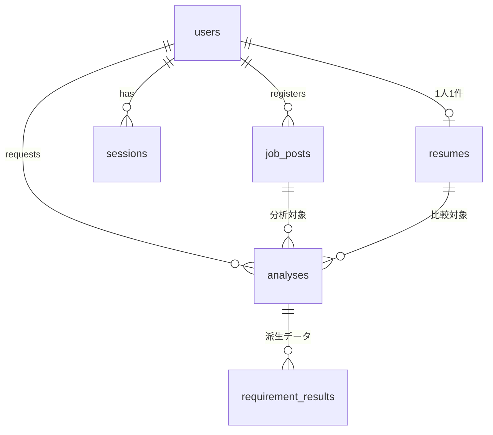

# データモデル



## テーブル一覧

| テーブル | 役割 |
|---|---|
| `users` | 会員 |
| `invite_codes` | 招待コード（登録時に検証し、使用回数を加算） |
| `sessions` | ログインセッション（[ADR-0003](adr/0003-authentication.md)） |
| `resumes` | 職務経歴書（1ユーザー1件） |
| `job_posts` | 求人票の原文と構造化結果 |
| `analyses` | 分析の実行単位。LLM出力の原本を保持 |
| `requirement_results` | 要件ごとの判定（原本から生成される派生データ、[ADR-0001](adr/0001-analysis-result-storage.md)） |

## カラム定義（案）

### users

| カラム | 型 | 備考 |
|---|---|---|
| id | BIGSERIAL | PK |
| email | TEXT | UNIQUE |
| password_hash | TEXT | Argon2id |
| created_at | TIMESTAMPTZ | |

### invite_codes

| カラム | 型 | 備考 |
|---|---|---|
| code | TEXT | PK |
| max_uses | INT | |
| used_count | INT | |
| expires_at | TIMESTAMPTZ | |

### resumes

| カラム | 型 | 備考 |
|---|---|---|
| id | BIGSERIAL | PK |
| user_id | BIGINT | FK、UNIQUE（1人1件） |
| raw_text | TEXT | 抽出済みテキスト |
| file_key | TEXT | S3のキー（ファイルアップロード時のみ） |
| updated_at | TIMESTAMPTZ | 再利用判定に使用 |

### job_posts

| カラム | 型 | 備考 |
|---|---|---|
| id | BIGSERIAL | PK |
| user_id | BIGINT | FK |
| raw_text | TEXT | 求人票の原文 |
| content_hash | TEXT | 原文のハッシュ。(user_id, content_hash) で UNIQUE |
| parsed | JSONB | 構造化した求人情報（下記） |
| created_at | TIMESTAMPTZ | |

`parsed` の構造（案）。日本の求人票に特化した項目を含む（[要件定義](requirements.md#日本の求人票に特化した機能)）。スキーマは `packages/shared` のZodで定義し、LLM出力の検証にも使う。

```json
{
  "requirements": {
    "required": ["Webアプリケーションの開発経験（3年以上）"],
    "preferred": ["TypeScriptを用いた開発経験"]
  },
  "compensation": {
    "annualMin": 8000000,
    "annualMax": 12000000,
    "fixedOvertime": {
      "included": true,
      "hours": 45,
      "amount": null,
      "baseSalaryExcludingFixedOvertime": null,
      "extraPayForExcess": true
    }
  },
  "employment": {
    "type": "正社員",
    "fixedTerm": false,
    "probation": { "exists": true, "months": 3, "conditionsDiffer": false },
    "scopeOfChange": { "duties": "会社の定める業務", "workplace": "会社の定める事業所" }
  },
  "workStyle": { "remote": "相談可", "flex": true, "coreTime": "10:00-15:00", "businessTrips": true },
  "foreignNational": {
    "japaneseLevel": "ネイティブレベル",
    "englishUsage": null,
    "visaSupport": null
  },
  "missingDisclosures": ["固定残業代の金額", "固定残業代を除いた基本給"]
}
```

* 求人票に記載がない項目は `null` とし、推測で埋めない。
* `missingDisclosures` には、明示が求められている項目のうち記載が見当たらないものを入れ、画面で「応募前に確認推奨」と表示する。

### analyses

| カラム | 型 | 備考 |
|---|---|---|
| id | BIGSERIAL | PK |
| user_id | BIGINT | FK |
| job_post_id | BIGINT | FK |
| resume_id | BIGINT | FK |
| status | TEXT | pending / processing / completed / failed |
| result | JSONB | LLM出力の原本（Source of Truth） |
| fit_score | INT | 一覧の並び替え用 |
| model | TEXT | 使用したモデル |
| prompt_version | TEXT | 使用したプロンプトのバージョン |
| input_tokens / output_tokens | INT | コスト計測用 |
| created_at | TIMESTAMPTZ | |

インデックス: `(user_id, created_at)` … 1日の利用回数カウント用

### requirement_results

[ADR-0001](adr/0001-analysis-result-storage.md) を参照。

## 設計上のポイント

- **1日の利用量制限**は専用テーブルを持たず、当日の `analyses` の件数で判定する。
- **`status`** は非同期処理（分析に数十秒かかる）を前提とした状態管理。
- **`model` / `prompt_version` / トークン数** は、LLMOps（プロンプト・モデルごとの品質とコストの比較）の元データとして最初から保存する。
